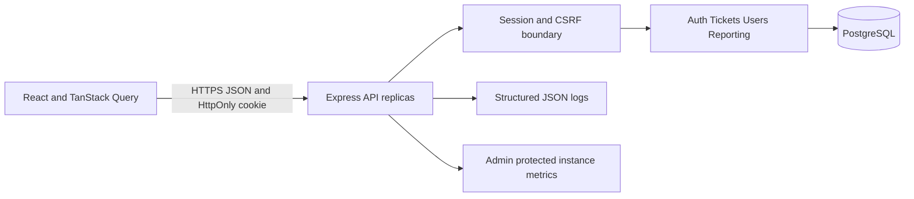

# SupportDesk Architecture

## Boundaries and trust

Browser route guards improve navigation; they are not an authorization boundary. The API validates strict mutation DTOs and derives actor identity from a signed JWT and an unexpired, unrevoked database session. The database role is reloaded on authentication; mutations reload it after user locks. Secrets and password hashes never enter response DTOs. CORS and mutation Origin checks restrict browser origins; CSRF is bound to each database session.

Each feature module owns HTTP adapters and application rules. Ticket policy is centralized; scoped predicates are applied before search, counts, pagination, and reporting. The ticket repository contains lock/idempotency/history primitives. User/reporting queries remain small and local to their modules; avoid inventing generic abstractions until reuse demands them.

## Domain invariants

1. Public signup cannot create staff accounts.
2. Customers see owned tickets; Agents see assigned tickets; Admins see all.
3. Mutation plus activity plus idempotency result commit together or roll back together.
4. Ticket version must match before edit/assignment/status/deletion. Competing edits cannot silently overwrite.
5. A valid assignment points to a current Agent; Agent demotion with assigned tickets is rejected.
6. Serialized role changes cannot demote the last Admin.
7. Repeated same-key/same-body creates or replies produce one resource; conflicting bodies return 409.
8. Logout invalidates the session in the database, including tokens copied before logout.

All identifiers are UUIDs except display ticket numbers, which use a database sequence. Sequence gaps are expected after rolled-back transactions and do not imply missing tickets.

## Concurrency and lock order

Role/assignment-sensitive operations first acquire the shared transaction advisory lock, then relevant User rows in sorted ID order, then a Ticket row if present. Other ticket writes lock the acting User before the Ticket. Services reload the actor and ticket policy inside the transaction. Assignment and reply therefore see a consistent order, and role changes cannot race assignment validation into invalid final state.

Idempotency locks use a transaction advisory hash of actor/operation/key. Create/reply records expire after 24 hours; replay rechecks ticket access. Hash collisions may serialize unrelated requests, but cannot merge their persisted records because the database unique constraint uses the full key tuple. A replay returns the currently authorized resource representation, not a byte-identical historical HTTP response. Replaying a deleted resource fails rather than recreating it.

Recognized serialization/deadlock aborts retry the entire transaction at most twice. Other errors, especially ambiguous commit outcomes, are not automatically replayed. The browser retains a create/reply key across explicit retries. A ticket conflict refreshes current data while preserving form text.

## Failure behavior

| Failure | Behavior |
| --- | --- |
| Invalid/revoked/expired session | 401; return to sign-in and clear private cached data |
| Database unavailable | Fail closed with 503; readiness fails, liveness remains healthy |
| Activity insertion fails | Entire mutation rolls back |
| Stale ticket version | 409 with reconciliation guidance |
| Response lost after create/reply commit | Reuse the same idempotency key; no duplicate write |
| Oversized request or invalid enum | 413 or 400 before domain work |
| Query/lock/pool wait exceeds limit | Bounded failure, safe response, correlated request ID |
| Deployment shutdown | Mark draining, stop accepting, complete in-flight work up to deadline |

## Scaling

An API replica owns no authoritative session or idempotency state. A second replica can use the same JWT secret/database without sticky sessions. Instance metrics must be aggregated by the hosting/monitoring layer; the current endpoint is not a distributed metric store. The login limiter is per-process until a gateway/shared limiter is configured.

Scale API replicas only when CPU/concurrency evidence shows database headroom. Budget `replicas × pool limit + maintenance connections` below database capacity. First optimize measured slow queries and indexes. Adopt cursors for deep ticket browsing, scoped caching/materialized summaries for costly reporting, and an outbox/worker only when notifications become a real feature. Each introduces a documented consistency or operational cost. See measured limits in performance notes.
